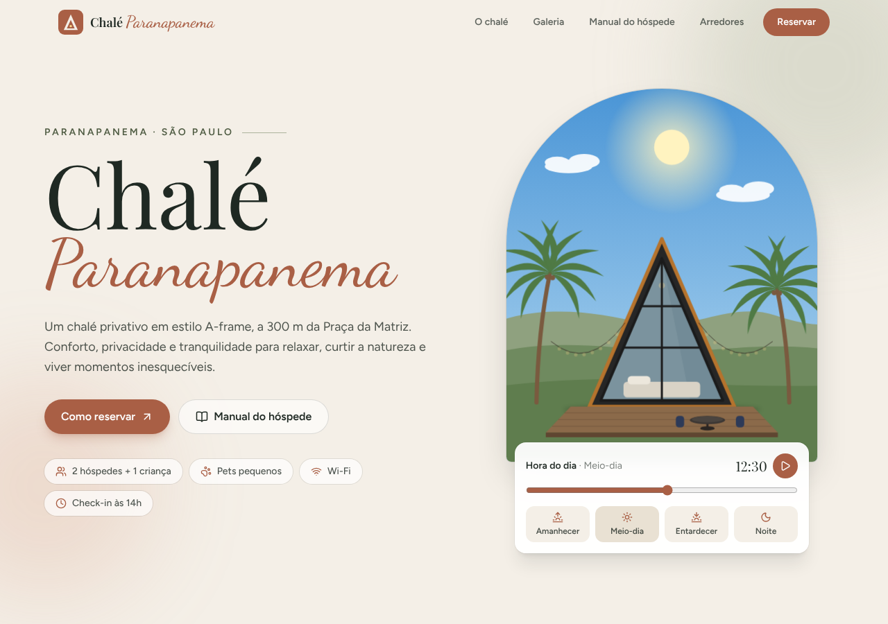
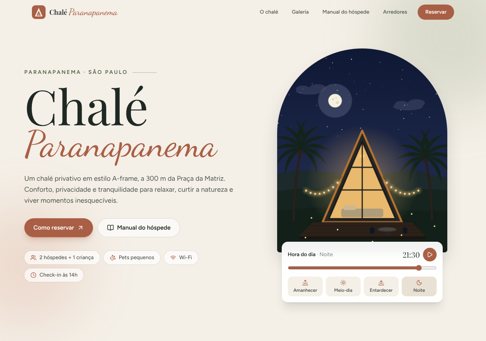

# Chalé Paranapanema

Site que desenvolvi para o chalé de hospedagem do meu pai, em Paranapanema (SP). Além de apresentar o chalé, ele transforma o manual do hóspede, que antes era um conjunto de imagens e PDFs, em uma experiência navegável: check-in passo a passo, regras com perguntas e respostas, checklist de saída e um guia da cidade.




## Destaques

- **Chalé ilustrado em SVG com ciclo do dia.** Um slider (ou o botão play) muda a hora: o céu, o sol, a lua, as estrelas, as luzinhas e a luz do chalé são calculados por interpolação de keyframes (`src/lib/color.ts`). Ao abrir, ele começa na hora real do visitante e tem parallax com o mouse.
- **Manual do hóspede interativo**, em abas acessíveis (navegação por setas do teclado):
  - *Check-in*: passo a passo com barra de progresso.
  - *Usando o chalé*: cards com ferramentas (copiar o nome do Wi-Fi, testar o termostato).
  - *Regras*: "Posso levar pet? Posso fumar?" e um verificador que diz se o grupo cabe nas regras.
  - *Antes de sair*: checklist com anel de progresso, salvo no `localStorage`.
- **Radar de distâncias** em escala logarítmica (100 m e 30 km no mesmo desenho), com link para o Google Maps de cada lugar.
- **Galeria com lightbox**, com teclado, foco gerenciado, setas e `Esc`.
- **Acessibilidade e performance:** HTML semântico, `aria-*`, foco visível, link "pular para o conteúdo", respeita `prefers-reduced-motion`, fontes self-hosted e imagens com `loading="lazy"`.
- **SEO:** metatags, Open Graph e dados estruturados (`schema.org/LodgingBusiness`).

## Stack

| Camada | Tecnologia |
| --- | --- |
| Build | Vite |
| UI | React 19 + TypeScript (strict) |
| Estilo | Tailwind CSS v4 |
| Animação | Motion |
| Ícones | lucide-react |
| Fontes | Fontsource (Playfair Display, Dancing Script, Figtree) |
| Deploy | GitHub Actions + GitHub Pages (demo) e Vercel (site real) |

## Rodando localmente

Requer [Node.js](https://nodejs.org) 20 ou mais novo.

```bash
npm install
npm run dev        # http://localhost:5173
npm run build      # confere os tipos e gera a pasta dist/
npm run preview    # serve o build para testar
```

## Dados privados

Link do Airbnb, WhatsApp e senha do Wi-Fi não ficam no código: entram por variáveis de ambiente na hora do build (veja `.env.example`). Sem elas, o site funciona normalmente em modo de demonstração (sem esses botões e com "senha informada na chegada").

Para testar com os dados reais, copie `.env.example` para `.env.local` (ignorado pelo Git) e preencha.

## Deploy

- **GitHub Pages (demo):** o workflow em `.github/workflows/deploy.yml` publica a cada push na `main`. Ative em Settings, Pages, Source: GitHub Actions.
- **Vercel (site real):** importe o repositório, cadastre as variáveis do `.env.example` em Settings, Environment Variables, e faça o deploy. O preset Vite é detectado sozinho.

O `vite.config.ts` usa `base: './'`, então o mesmo build funciona em qualquer hospedagem estática.

## Estrutura

```
src/
  components/
    hero/        Scene.tsx (ilustração SVG) e Hero.tsx (slider, parallax)
    guide/       Manual: CheckIn, Usage, Rules, Checkout e as abas (Guide)
    About, Gallery, Explore, Contact, Header, Footer, ui
  data/site.ts   Configuração e conteúdo
  lib/           color.ts (interpolação do dia), hooks.ts (localStorage, scroll-spy, copiar)
public/photos/   Fotos do chalé e da cidade
```

## Licença

Código sob licença MIT. Fotos e textos do chalé: todos os direitos reservados aos proprietários.
